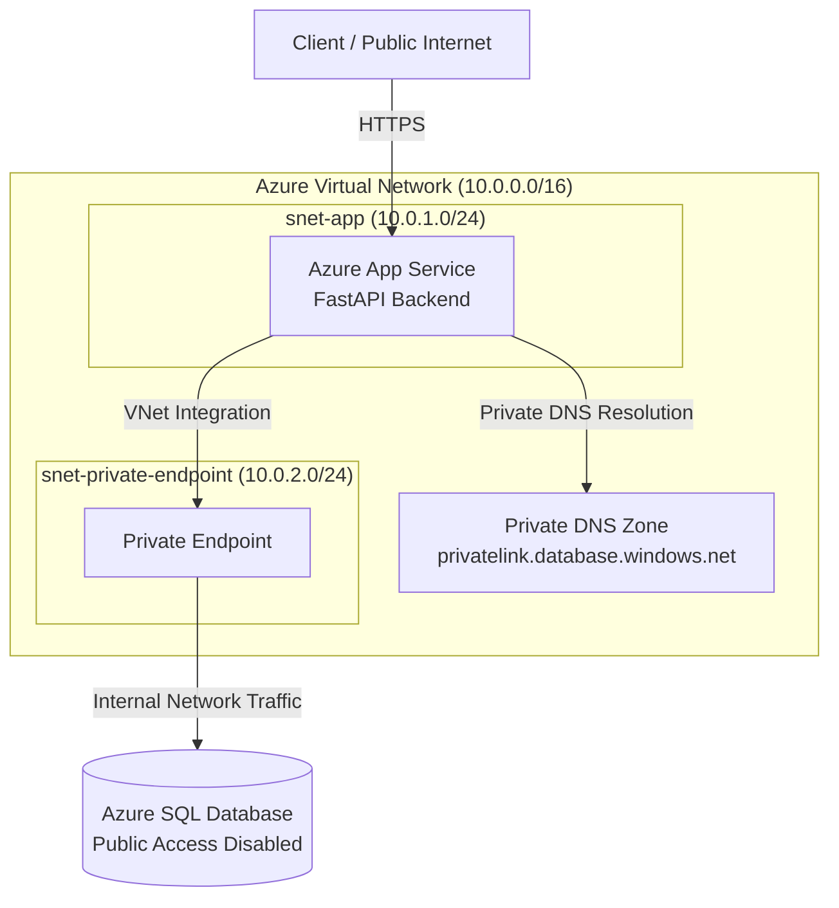
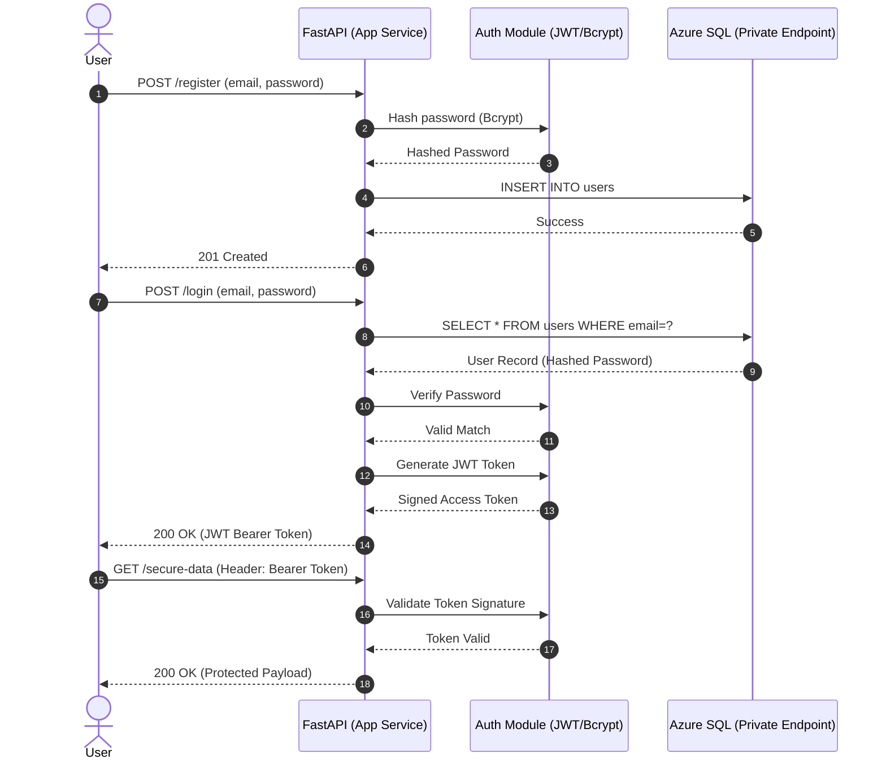

# Network Guard - Secure Azure Infrastructure

[](https://www.python.org/)
[](https://fastapi.tiangolo.com/)
[](https://azure.microsoft.com/)
[](https://www.terraform.io/)

## 1. Project Overview

**Network Guard** is a secure, cloud-native Python (FastAPI) backend designed with a **Zero-Trust architecture**. The project demonstrates an end-to-end cloud engineering approach, combining a robust RESTful authentication API with Infrastructure as Code (IaC) to provision a completely isolated Azure networking and database environment.

### Core Technologies

- **Backend Framework:** Python 3.11, FastAPI, SQLAlchemy
- **Security & Auth:** JWT (JSON Web Tokens), Bcrypt password hashing
- **Cloud Infrastructure:** Microsoft Azure (Virtual Network, App Service, Azure SQL)
- **Infrastructure as Code:** Terraform
- **Networking & Isolation:** Private Endpoints, Private DNS Zones, VNet Integration

---

## 2. Architecture Design

The architecture enforces a strict **Zero-Trust model**. The Azure SQL Database is completely isolated from the public internet (`public_network_access_enabled = false`). Database traffic is routed exclusively through a Private Endpoint inside the Virtual Network.

### 2.1 Network Topology Diagram



### 2.2 Authentication Flow Sequence



---

## 3. Infrastructure as Code (Terraform)

The complete Azure cloud environment is fully codified using Terraform under the `terraform/` directory.

### Resources Provisioned

- **Resource Group:** `rg-network-guard`
- **Virtual Network:** `vnet-network-guard` (`10.0.0.0/16`)
- **Subnets:**
  - `snet-app` (`10.0.1.0/24`): delegated to `Microsoft.Web/serverFarms` for App Service VNet Integration.
  - `snet-private-endpoint` (`10.0.2.0/24`): hosts the Azure SQL Private Endpoint.
- **Azure SQL Server & Database:** Basic tier, public network access explicitly disabled.
- **Private Endpoint:** Secures the connection to the SQL database without exposing public IP routes.
- **Private DNS Zone:** `privatelink.database.windows.net`, linked to the VNet for internal name resolution.
- **App Service Plan:** Linux-based, configured for VNet Integration.

---

## 4. Cloud Deployment Constraints (Subscription Policy Note)

While the entire infrastructure stack is fully codified and validated in Terraform, live provisioning of the Azure Web App VNet integration encountered regional subscription quotas under Azure for Students:

- The F1 (Free) App Service SKU does not support VNet Integration.
- Upgrading to the B1 (Basic) tier requires core quota increases, which are blocked by regional student subscription limits.

> **Note:** The Terraform code in `terraform/` is production-ready. In a standard corporate/enterprise subscription with standard quotas, running `terraform apply` provisions the entire isolated network seamlessly.

---

## 5. Local Development Guide

To run and test the FastAPI authentication backend locally:

### 1. Clone the Repository

```bash
git clone https://github.com/ThebeLedwaba/network-guard.git
cd network-guard
```

### 2. Set Up a Virtual Environment

```bash
# Create virtual environment
python -m venv venv

# Activate on Windows:
venv\Scripts\activate

# Activate on Linux/macOS:
source venv/bin/activate
```

### 3. Install Dependencies

```bash
pip install -r requirements.txt
```

### 4. Run the Application

```bash
uvicorn app.main:app --reload
```

### 5. Interactive API Documentation

Once running, open the interactive Swagger UI at: <http://127.0.0.1:8000/docs>

---

## 6. Repository Structure

```text
network-guard/
├── app/
│   ├── __init__.py
│   ├── auth.py         # JWT generation & Bcrypt hashing logic
│   ├── database.py     # SQLAlchemy DB connection session setup
│   ├── main.py         # FastAPI routes and endpoints
│   └── models.py       # DB schema models
├── terraform/
│   ├── main.tf         # Azure provider resources, VNet, SQL, Private Endpoint
│   ├── providers.tf    # Terraform & AzureRM provider configuration
│   └── variables.tf    # Variable definitions (regions, CIDRs, credentials)
├── .gitignore
├── README.md
└── requirements.txt
```
